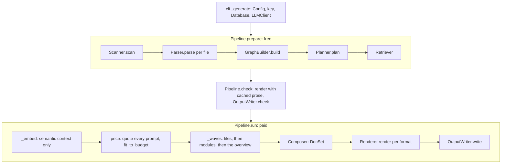
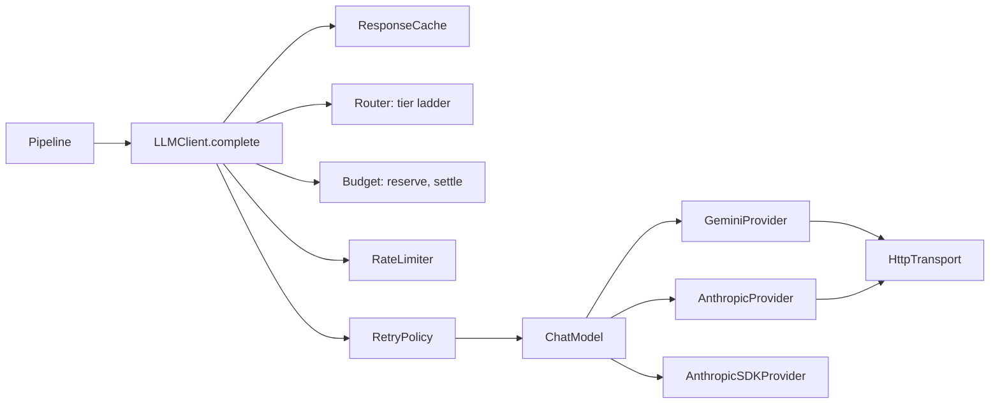
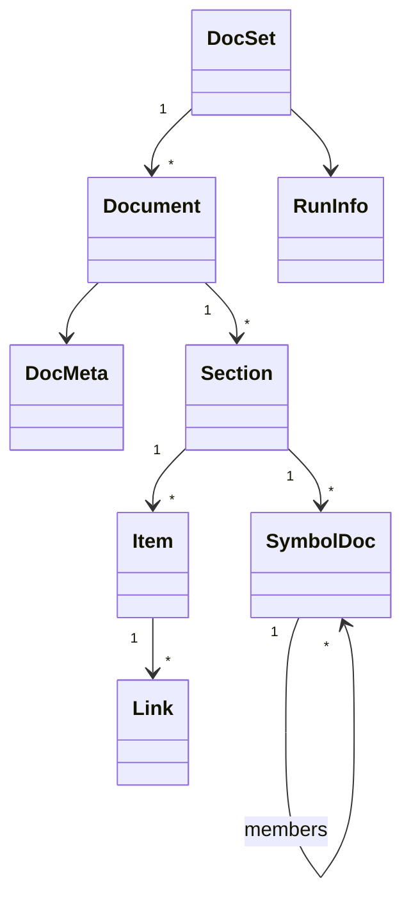
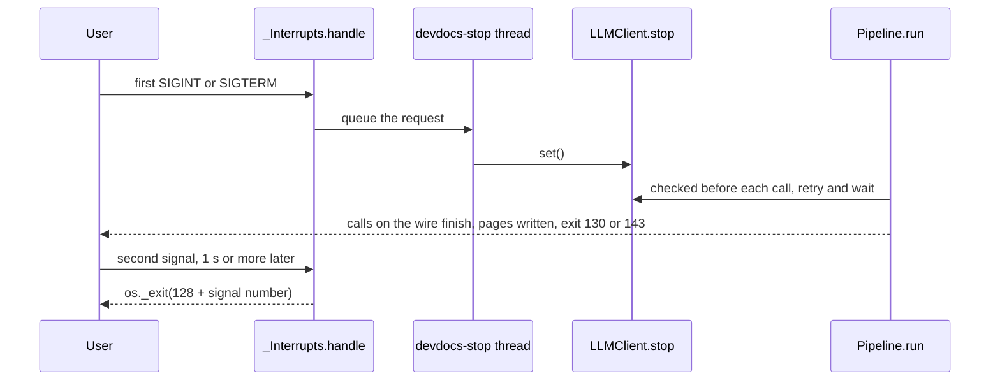

# Architecture

This page is for contributors. It explains how devdocs is built: the principles behind it, where each part lives, how a run goes from scanning a project to writing files, and how to extend it. To use devdocs, start at the [documentation index](README.md). To set up a checkout and send a change, read [CONTRIBUTING.md](../CONTRIBUTING.md).

devdocs has no public plugin API in 4.0.0. `devdocs.__all__` lists only `__version__`, and the package docstring says that anything not listed is private and may change without a major version bump. The parser registry, the `ChatModel` protocol and the renderers described under [Extension points](#extension-points) are for contributors changing the code in this repository, not an interface for third-party packages.

## Design principles

- **Standard library only.** `pyproject.toml` declares `dependencies = []`. Providers are reached through `http.client`, state lives in `sqlite3`, and the gitignore matcher, the parsers, the diagram layout and the PDF writer are written here. The one runtime extra, `anthropic`, installs Anthropic's SDK for the `anthropic-sdk` provider. The development tools are the `dev` extra, which a plain install leaves out. Python 3.11 is the oldest supported version.
- **Facts from parsers, prose from a model only where it adds something.** What a page says about the code (signatures, members, imports, dependencies, entry points) comes from a parser or the import graph, and its known issues from the TODO-style markers in its comments. Signatures are taken from the source text, never rebuilt from a syntax tree. A model writes only what code cannot say: a file's or module's purpose, a sentence for each undocumented public symbol, notes on behaviour, how modules relate, and the project's overview, data flow and extension points. Unless the quality is `high`, the planner leaves a file whose docstrings already document it as a stub, a page built from facts alone. The style guard checks every name a reply cites in a code span against the names the project defines or imports, its file names, Python's builtins, common JavaScript globals and keywords such as `self` or `null`. That set is the same for every language, so a Rust `Vec` that the project does not import counts as unknown; literals, such as numbers, paths, flags and upper-case constants, pass. A note, relation, flow step or extension point that cites an unknown name is dropped; in a purpose or a symbol's sentence, the unknown name loses its code formatting.
- **Cost first.** Nothing is bought before it is priced. `Pipeline.prepare` costs nothing. `Pipeline.price` builds every prompt the run would send, quotes each against the model catalog and the response cache, and cuts the plan to the budget, `max_cost` and `max_requests`, before the first call; a limit of 0 means no limit, not zero spend. `LLMClient` reserves an upper bound on each call's cost before sending it, sends each kind of work to the model the catalog assigns to its tier, and calls the next tier's model only when an answer is unusable or no model of the tier is left to call. Requests are paced to free-tier limits by default. Retrieved context is kept out of the cache key, so editing a neighbouring file does not buy an answer again.
- **Resumable runs.** Every usable answer is cached the moment it lands. A run stopped by its budget, a spent quota or a first stop signal still writes its pages, from the answers it has and as stubs for the rest, and the next run takes the cached answers for free. `Pipeline.check` refuses, before anything is bought, a run whose output the writer would refuse. A file that appears at an output path during the paid part is refused only when the run writes, with the answers bought already cached.

## Module map

Paths are relative to `devdocs/`.

### Entry points and configuration

| Module | Job |
|---|---|
| `__main__.py` | `python -m devdocs`, the same command line as the `devdocs` script. |
| `cli.py` | The argparse front end, the seven commands, output and exit statuses, and stop-signal handling (`_Interrupts`). |
| `legacy.py` | Recognises and translates v3 command lines. Defines `KeyMaskingParser`, the argparse parser both command lines use, whose argument errors mask any API key the command line names. |
| `config.py` | `Config`; precedence (flag, then environment, then `devdocs.toml`, then default); the config-file search; path checks; API key resolution (`resolve_api_key`). |
| `errors.py` | The typed exceptions, each carrying its exit code. |
| `capabilities.py` | Runtime probes for `doctor`: Python, syntax support, SQLite and its thread safety, TLS, CA certificates. |
| `demo.py` | The shared demo key slot. It is empty in 4.0.0. |

### Scanning and parsing

| Module | Job |
|---|---|
| `scan.py` | `Scanner`: walks the tree without changing directory, applies the ignore rules, and gives each file a language and a role (`source`, `test`, `config`, `docs`, `generated`, `vendored`, `data`). |
| `ignore.py` | `GitignoreMatcher`: git's ignore rules, implemented without `pathspec`. |
| `parse/__init__.py` | The fact types (`FileFacts`, `Symbol`, `Confidence`), the `Parser` protocol and the registry (`register`, `get_parser`). |
| `parse/python.py` | `PythonParser`: `ast`, with a token-scan fallback when `ast` cannot parse a file. |
| `parse/generic.py` | `GenericParser`: a declarative scanner for brace-delimited languages, driven by a `LanguageSpec`. |
| `parse/languages.py` | The specs for JavaScript and TypeScript, Go, Rust and Java. |
| `parse/masking.py` | `mask()`: blanks comments and string contents without moving any offset. |

### Analysis and planning

| Module | Job |
|---|---|
| `graph.py` | `GraphBuilder`, which resolves imports per language into a `ProjectGraph`: dependents, module edges, entry points. |
| `history.py` | `GitHistory`: recent commits and authors per file, through the `git` command. Without git every answer is empty. |
| `issues.py` | TODO, FIXME, XXX, HACK and BUG markers, read from comments only. |
| `plan.py` | `Planner`: prose or stub for every file, module and the overview; `fit_to_budget`. |
| `context.py` | `StructuralContext`: exact cross-file snippets taken from the graph. |
| `retrieve.py` | `Retriever`: structural context first, then BM25 and, in semantic mode, vector hits, fused by reciprocal rank. |

### Prompts, prose and the run

| Module | Job |
|---|---|
| `prompting.py` | `PromptBuilder`: the file, module and architecture prompts, with source excerpts that fit a token budget. |
| `prompts/` | The three system prompts, `file.md`, `module.md` and `architecture.md`, as package data. A prompt file's leading HTML comment is a note for maintainers and is never sent. |
| `render/style.py` | The output contract for model prose: `parse_reply`, `StyleGuard` and `acceptable`. |
| `compose.py` | `Composer`: builds each `Document` from facts plus any prose. |
| `generate.py` | `Pipeline`: prepare, check, price, run, compose, write and export. |

### Model layer (`llm/`)

| Module | Job |
|---|---|
| `llm/__init__.py` | The provider-neutral types (`Request`, `Completion`, `Usage`, `Finish`) and the `ChatModel` and `Embedder` protocols. |
| `llm/http.py` | `HttpTransport` (pooled keep-alive connections, gzip, a TLS 1.2 floor, proxies) and `RetryPolicy`. |
| `llm/providers.py` | `GeminiProvider` and `AnthropicProvider` over raw HTTP, and Gemini embeddings. |
| `llm/anthropic_sdk.py` | `AnthropicSDKProvider`, through the optional `anthropic` package. |
| `llm/factory.py` | `PROVIDERS`, `make_provider()`, and `OfflineModel`, which refuses to send anything. |
| `llm/catalog.py` | Models as data: tier, prices, limits and accepted parameters; `PRICES_CHECKED`. |
| `llm/budget.py` | `Router` (which model), `RateLimiter` (how fast) and `Budget` (when to stop). |
| `llm/client.py` | `LLMClient`, the one door every completion goes through. |
| `llm/stop.py` | Stopping a run on request: `leave_signals()`, and `Interrupted`, re-exported from `errors.py`. |

### State (`index/`)

| Module | Job |
|---|---|
| `index/db.py` | `Database`: the SQLite file, the migration chain, per-thread connections. |
| `index/cache.py` | `ResponseCache`: answers already paid for. |
| `index/ledger.py` | `RunLedger` (how each run ended) and `DailyUsage` (requests and spend per model per quota day). |
| `index/chunk.py` | `chunk_file()` and `ChunkStore`: chunks at symbol boundaries, with content-addressed ids and stored vectors. |
| `index/embed.py` | `Embeddings`: buys the vectors a run's chunks lack, on the run's budget. |
| `index/search.py` | `LexicalIndex` (BM25, in memory), `VectorIndex` and `fuse()`. |

### Documents and output (`render/`)

| Module | Job |
|---|---|
| `render/model.py` | The document model: `DocSet`, `Document`, `Section`, `SymbolDoc`, `RunInfo`, `Layout`. |
| `render/__init__.py` | The `Renderer` protocol, `renderer_for()`, `OutputWriter` and `read_manifest()`. |
| `render/text.py` | Text helpers the renderers share, such as `code_spans`, `relpath` and `claim`. |
| `render/markdown.py` | `MarkdownRenderer`: one page per document plus a `README.md` index. |
| `render/html.py` | `HtmlRenderer`: a static site, or with `book=True` one `book.html` for an external PDF engine. |
| `render/diagram.py` | Lays out the Mermaid flowcharts the composer writes, as geometry for SVG and PDF. |
| `render/pdf/__init__.py` | `PdfRenderer`: one bound book, or one file per document, through the built-in engine or an external one. |
| `render/pdf/layout.py`, `writer.py`, `fonts.py` | The built-in engine: typesetting, PDF objects and serialization, standard-font metrics and WinAnsi encoding. |
| `render/pdf/external.py` | Finds and runs Chrome, Chromium, Edge or WeasyPrint to print the HTML book. |
| `render/pdf/check.py` | A strict PDF parser that the tests use to validate the PDFs the code writes. |
| `render/assets/` | `style.css` and `filter.js`, copied into the HTML site. |

Imports are kept lazy where they are expensive. `cli` imports `generate` inside the command handlers, so `devdocs --help` never loads the pipeline. `renderer_for` imports a renderer only when its format is asked for, `make_provider` imports a provider only when it is chosen, and `parse` loads the built-in parsers on the first `get_parser()` call, under a lock.

## A run, from scan to render

`devdocs generate` drives the classes below. Everything before `Pipeline.run` is free: no completion is requested before it, and the provider is contacted only by `client.discover()`, which lists the models the key can reach.

### 1. Setting up (`cli._generate`)

1. `_config` calls `load_config`, which resolves every setting and checks the paths before anything exists on disk: the project root must be a directory devdocs can list and search, and the output directory must not be the root or above it. Each failure is a `ConfigError`.
2. `_key` calls `resolve_api_key`. A missing key is a `ConfigError` too, so it is also reported before anything is created.
3. `_state` opens `<project>/.devdocs/devdocs.db` and migrates it. `generate` is the only command that creates it.
4. `_client` wraps `make_provider(config.provider, key)` in an `LLMClient` with a `Router`, a `Budget`, the `ResponseCache`, `DailyUsage` and the run's stop signal.
5. `Pipeline(...)` builds one renderer per configured format through `renderer_for`, so a missing external PDF engine fails here, before any call.
6. `client.discover()` lists the models the key can reach.

### 2. `Pipeline.prepare`: everything that costs nothing

`prepare` returns a `Prepared`, which carries everything later steps need:

1. `Scanner(root, include=..., exclude=...).scan()` gives a `ScanResult`: each `SourceFile` with its language and role, plus what was skipped and why.
2. Files that a devdocs manifest lists as its own output are dropped from the scan, so a run never documents pages or site scripts devdocs wrote.
3. Each file with a language is read. When `get_parser(language)` returns a parser, its `parse(path, text)` gives the file's `FileFacts`. A file whose language has no parser gets no facts, and the planner makes its page a stub (`no parser for <language>`). A parser must not raise; if one does anyway, the pipeline records `FAILED` facts for that file and goes on.
4. `GraphBuilder(...).build()` resolves imports into a `ProjectGraph`. `GitHistory` adds recent activity when git is available.
5. `Planner(...).plan(...)` decides `PROSE` or `STUB` for each file, each module (directory) and the architecture overview. The `quality` setting picks the planner's coverage.
6. Known issues, source hashes and, unless context is `off`, the `Retriever` with its chunks and lexical index are built.

Scanning, parsing, graphing and planning run on one thread. `concurrency` applies only to the completion waves; embedding batches go one at a time.

### 3. `Pipeline.check`: refuse before paying

Which files a run writes depends on its documents, not on their prose. `check` composes the documents with the prose the cache already holds and a placeholder for prose still to buy, renders them (with the built-in PDF engine standing in for an external one), and calls `OutputWriter.check`, which runs the writer's own checks without changing anything. A file devdocs has no record of writing, a name the file system cannot hold or an output directory devdocs cannot write is refused here, as a `ConfigError`, before the first paid call. The CLI calls `check` itself, outside the part of the run where a stop is graceful, and passes `checked=True` to `run`; a library caller gets the check from `run`.

### 4. `Pipeline.price` and `estimate`

`price` walks the prompts a run would build, in order: one per file planned for prose, one per module planned for prose, and the architecture prompt when the overview is planned for prose. Module prompts carry the file purposes the run would have by then, read from cached answers or taken from docstrings. Each prompt is quoted with `client.quote`, which marks it `cached` when one of its tier's candidates has already answered it. The candidates are `Router.candidates`, which is `catalog.tier_models`: every model the catalog routes at the tier the ladder starts from and at each tier above, callable or not; with `--model`, only the pinned model. They never include a model below the starting tier, which free-tier mode can call to fill a tier that has no free model left. Such an answer is cached but not read back, so the next run asks again, unless `--model` pins that model.

`fit_to_budget` then walks the `PROSE` items in priority order, the overview first, then modules by score, then files by value. It keeps each item whose calls still fit `max_cost` and `max_requests` and demotes the rest to `STUB`; a cut does not end the walk, so a cheaper item after it may still fit. A cached answer costs nothing and is never cut. Buying an item, though, asks again the cached answers that sum it up, a file's module summary and then the architecture overview, up to the first that is not cached or that an item kept earlier already asks again. Those calls count against the limits, and the item is kept only if they all fit. A limit of 0 means no limit, not zero spend.

`Pipeline.estimate` is `price` and nothing more, so `devdocs estimate` describes the run that would follow it. Both only read the index.

### 5. `Pipeline.run`: the paid part

1. `_embed`, in semantic mode only, brings the chunk store up to date and buys missing vectors through `Embeddings`, within half of each limit. If embedding fails after its retries, the run goes on and files without vectors get standard context.
2. `price` runs again with the final retriever.
3. `RunLedger.start` reopens the newest unfinished run with the same configuration fingerprint, a hash of the project root, provider, quality, include and exclude, or starts a new one, as it always does with `--no-resume`. Reopening changes only the run record: what spares a resumed run from paying again is the response cache.
4. `_waves` sends three waves in order: files; then modules, whose prompts sum up the files' purposes; then the architecture overview, which sums up the modules'. Each wave runs on a `ThreadPoolExecutor` of at most `concurrency` workers, most valuable prompt first. Each call goes through `LLMClient.complete`, and a reply is parsed and passed through the style guard before it is accepted, so an unusable reply escalates instead of being cached.
5. `_settle` records each result. A budget stop or a quota stop ends the asking, an `AuthError` or `ConfigError` aborts the run, and any other `DevDocsError`, or a call that ends with no usable reply, marks that item failed.
6. `_compose` builds the `DocSet`: one document per planned file, one per module, and the architecture document when the project has any documentable file. Prose is attached where the run has an answer, bought now or read from the cache; every other document is a stub built from facts.
7. `write` renders each format and hands the files to `OutputWriter.write`. A renderer that raises a `DevDocsError` is recorded as a failed format, whose hint names the `devdocs export` command that makes it later from the manifest. The other formats are still written, without pruning, so the failed format's earlier files stay listed. If the writer refuses now, as for a file that appeared at an output path during the paid part, `run` raises its `ConfigError` with the hint extended by `_again`, which says what running again costs.
8. `RunLedger.finish` records the run as `finished`, or as `interrupted` when it stopped early or anything failed.

`export` skips all of this: it reads the `DocSet` back from `index.json` with `read_manifest`, renders it again, and adds the files with `OutputWriter.add`. It needs no key and no database.

## The database

All state lives in one SQLite file, `<project>/.devdocs/devdocs.db`, so a run has one place to migrate and one transaction boundary. No setting moves it. Only `generate` creates it. `estimate` and `cache` open it with `Database(create=False)`, which uses an empty in-memory database when no file exists yet.

| Table | Holds | Written by |
|---|---|---|
| `response_cache` | Usable answers, keyed by a hash of `CACHE_VERSION`, the provider, model, system prompt, prompt (without its retrieved context), output cap, temperature and effort. | `generate`, for each usable answer it buys. |
| `chunk` | Chunk ids, sources, start lines and embedding vectors with their model and dimensions. Chunk text comes from the run's own scan. | `generate` in semantic mode. |
| `run` | One row per run: id, start time, status, configuration fingerprint. | Every `generate` that passes the check. |
| `usage_day` | Requests and spend per model per quota day, so pacing and daily caps carry across runs. | `generate`, for each answered call and embedding batch. |

- **Migrations.** `MIGRATIONS` in `index/db.py` is an append-only tuple of SQL scripts, and `SCHEMA_VERSION` is its length, stored in `PRAGMA user_version`. Each step runs in one `BEGIN IMMEDIATE` transaction with its version bump, executing its statements one at a time (`executescript` would commit after each). A file from a newer devdocs is refused with a `StorageError`. To change the schema, append a migration; never edit one that has shipped. Migration 4 rebuilds tables instead of using `DROP COLUMN`, which needs SQLite 3.35.
- **Connections.** One `Database` per run and one connection per thread (`threading.local()`), because `sqlite3.threadsafety` is 1 on some builds. Connections use WAL and `synchronous = NORMAL`. `Database(":memory:")` is a private temporary file, so a thread pool can share it.
- **Errors.** No raw `sqlite3.Error` leaves `db.py`. Reads go through `query` and `query_one` and writes through `transaction`, all of which raise `StorageError` with a hint for a busy, damaged, denied or full file.
- **Repositories.** `ResponseCache`, `RunLedger`, `DailyUsage` and `ChunkStore` receive the `Database` and never open, commit or migrate it themselves. Each write is its own transaction, so a paid answer is stored the moment it lands. `cache clear` deletes `response_cache` rows only.
- **Cache keys.** A changed prompt changes its key by itself. To invalidate every cached answer after a change the key cannot see, bump `CACHE_VERSION` in `index/cache.py`.

## The LLM layer

- **Protocols.** `ChatModel` has a `provider` name, `generate(Request) -> Completion` and `list_models()`. `generate` raises the typed errors from `devdocs.errors` for transport and API failures, and returns a `Completion` with `text=None` for a response that carried no content. `Embedder` is a separate protocol (`provider`, `dimensions`, `embed(texts)`), and only `GeminiProvider` implements it.
- **Providers.** `GeminiProvider` and `AnthropicProvider` speak each vendor's HTTP API through `HttpTransport` and map its errors: a rejected key (401, 403, or the vendor's own invalid-key error) to `AuthError`; a spent daily quota, a spend cap or a billing error to `QuotaExhausted`; any other 429 to `RateLimited`; an unknown model to `ModelNotFound`; and the rest to `ProviderError`. Gemini's key travels in the `x-goog-api-key` header and Anthropic's in `x-api-key`, never in a URL. `AnthropicSDKProvider` reports its provider as `anthropic`, so it shares the catalog entries, prices and cached answers of the raw-HTTP client. `OfflineModel` backs `estimate`: a client around it can quote and read the cache, and it raises `ConfigError` if asked to send.
- **Transport.** `HttpTransport` keeps connections alive, per host and per thread, decodes gzip and deflate with a cap on the decompressed size, enforces TLS 1.2 or later, honours HTTPS proxies and `NO_PROXY`, and times out each socket operation after 120 seconds. It never delivers a request twice once the server may have it.
- **Retries.** `RetryPolicy` retries only failures that can succeed on another try (network errors, a rate limit, a 5xx), up to 4 attempts, with jittered exponential backoff capped at 60 seconds. A delay the server gives replaces the backoff, and a delay over 120 seconds is not waited for.
- **Catalog.** `llm/catalog.py` holds models as data. Each tier (`file`, `module`, `architecture`, `embed`) maps to models per provider in order of preference. `find` looks a model up, and `assume` prices an unknown one at the most its vendor charges, so an unfamiliar model never makes a budget look larger than it is. `PRICES_CHECKED` dates the prices, and `doctor` warns when that date is over 180 days old.
- **Routing and limits.** `Router` builds the ladder for a call: the model for the work's tier first, then one model per tier above it. `quality` shifts where the ladder starts, `--model` pins one model, and free-tier mode skips models outside the free tier of a provider that has one, serving a tier left without a free model by the strongest free model below it. `RateLimiter` paces requests per model and raises `QuotaExhausted` when a daily cap is reached. `Budget` keeps spend in integer micro-dollars and requests as a count, retries included; a limit of 0 turns that limit off.
- **`LLMClient.complete`.** Every completion goes through it, in this order:
  1. the cache, over the tier's candidates (`Router.candidates`): the models of the tier and above, then the free models below it, for the answers they gave it on loan, which `Router.lent` keys apart from their own. A hit is free;
  2. the stop signal: once set, nothing is sent;
  3. the budget: an upper bound on the call's cost is reserved, and the call is refused if it would pass a limit;
  4. the rate limiter;
  5. the call. `RetryPolicy` runs steps 3 to 5 once per attempt;
  6. settlement at the dearer of the requested and the serving model's prices, recorded in `DailyUsage`, and the answer cached if usable.

  The ladder is read again after every attempt. A `ModelNotFound` retires that model for the run, a spent quota retires it until the quota day turns, and an unusable answer moves up one tier. A safety block or refusal is returned as it is, since a stronger model from the same vendor applies the same policy.
- **Embeddings.** `Embeddings` in `index/embed.py` sends batches through the same `Budget`, `RateLimiter`, `RetryPolicy` and `DailyUsage` as completions, and stores vectors per model, keyed by content-addressed chunk ids, so an unchanged declaration keeps the vector already paid for.

## The document model and renderers

The model is `DocSet`, in `render/model.py`; there is no class named `DocModel`. Markdown, HTML and PDF are projections of one `DocSet`, and none of them is the source of truth.

- **Documents.** A `Document` has an `id` (`file:<path>`, `module:<dir>` or `architecture`), a kind (`file`, `module`, `architecture`), a title, an output `path` without extension, sections and a `DocMeta`. `DocMeta.mode` is `prose` or `stub`. Sections come in a fixed order per kind (`SECTION_ORDER`), and a section with nothing to say is left out.
- **Stable identity.** Ids come from a document's kind and source path and from a symbol's file and qualified name, never from order, so links survive a regeneration and an edit to one file changes only that file's document. `DocMeta` has no timestamp: `RunInfo`, on the `DocSet`, is the only place one appears.
- **Layout.** `Layout` maps documents to output paths: `shop/cart.py` for a file (or `shop/cart` with `per_file`, unless that collides), `<dir>/index` for a module and `architecture` for the overview. `DocSet.sorted()` gives every renderer one reading order.
- **Schema.** The manifest, `index.json`, is the JSON form of `DocSet.to_dict()` plus `files`, the list of files devdocs wrote there. `SCHEMA_VERSION` (`1.0.0`) follows semver: an additive change bumps the minor version, and a change that would break a reader bumps the major. `DocSet.from_dict` refuses a different major version.
- **Renderers.** `MarkdownRenderer`, `HtmlRenderer` and `PdfRenderer` each map a `DocSet` to `{relative POSIX path: bytes}` and never call a model. The built-in PDF engine needs nothing installed: it typesets with the standard PDF fonts and prints characters outside WinAnsi as `?`, reporting each as a warning. The `chrome` and `weasyprint` engines print `HtmlRenderer(book=True)` output instead, for all of Unicode. `render/diagram.py` lays out the Mermaid subset the composer writes, so HTML and PDF draw diagrams without a Mermaid runtime.
- **Writing.** `OutputWriter` writes each file to a temporary file beside its target and renames it into place, leaves unchanged files alone, and replaces or prunes only files its manifest, `index.json`, lists. The manifest is written before the pages and again after them. A file devdocs has no record of writing is refused unless `force` is set. `check` makes every probe and refusal of `write` without changing anything, and `add` adds files without pruning, for `export`.

## Errors, exit codes and stopping

### Errors

Every deliberate failure is a subclass of `DevDocsError` in `devdocs/errors.py`: `ConfigError`, `AuthError`, `ProviderError` (with its subclasses `RateLimited`, `ModelNotFound` and `QuotaExhausted`), `BudgetExceeded`, `StorageError` and `Interrupted`. Each class carries the exit status the CLI returns as its `exit_code` attribute, so no lookup table can drift from the classes, and the module docstring lists them all. `str()` of an error is its message, followed by a second line, `  hint: ...`, when it has a hint. Exit codes are part of the public contract, and `tests/test_errors.py` pins them, including that 8 stays unused; [commands.md](commands.md#exit-codes) is where they are documented for users.

`cli.main` handles failures in one place:

- a `DevDocsError` prints `devdocs: error: <message>` and returns its `exit_code`;
- `KeyboardInterrupt` or `Interrupted` prints `warning: interrupted; ` and what the stop left, and returns 130, or 143 when SIGTERM asked for the stop;
- any other exception is a bug: it prints `devdocs: internal error: <type>: <message>` and returns 1, and with `DEVDOCS_DEBUG` set it is raised again with its traceback.

`generate` also turns its result into a status, the first that applies: 130 or 143 after a stop request, 7 after a budget stop, 10 after a quota stop, 4 when any item or format failed, else 0. Failures are contained where they happen: a parser degrades a file to lower confidence instead of raising, a failed item becomes a stub, and a failed format costs only itself.

When you raise an error, pick the class by what the user can do about it, and give a hint when the fix is known. Never raise a bare `Exception` for a condition you expect: it reads as an internal error.

### Stopping

- `cli.main` installs `_Interrupts.handle` for SIGINT and SIGTERM around every command, skipping a signal the platform lacks, one ignored at startup or one handled outside Python, and restores the previous handlers afterwards.
- Outside `_Interrupts.paying()`, which wraps only `Pipeline.run`, the first signal raises `KeyboardInterrupt` at once: nothing bought is in flight.
- Inside it, the first signal queues a request, and the `devdocs-stop` relay thread sets the run's stop signal, a `threading.Event` that `LLMClient.stop` holds. The handler cannot set it itself, because it may interrupt a wait on that same event. Once it is set, `LLMClient.complete` refuses to send, `RetryPolicy` refuses to retry, and waits on `RateLimiter` and on retry backoff end at once, each raising `Interrupted`. `Embeddings` starts no further batch. Calls already on the wire finish and are cached, the waves run on through the cache, every page is written, and the ledger records the run as `interrupted`.
- `Interrupted` is not a `ProviderError`, so it is never retried and never counted as a failure: the work it refused stays for the next run.
- Pool workers and the relay thread call `leave_signals()`, which blocks SIGINT and SIGTERM in their thread, so the kernel delivers signals to the main thread, where Python runs handlers.
- A second signal within one second of the first (`_SAME_REQUEST`) counts as the same request, since one sent to a process group can arrive twice. A later one ends the process with `os._exit(128 + signum)`, abandoning calls on the wire; their answers are lost, but those already received are cached.
- A graceful stop exits with 128 plus the first signal's number, a hard stop with 128 plus the second's.

[How a run stops](commands.md#how-a-run-stops) describes the same behaviour from the user's side.

## Extension points

The code names three extension points: `Parser` for languages, `ChatModel` for providers and `Renderer` for output formats. All three are `typing.Protocol` classes, so an implementation needs no base class. There is no plugin discovery: no entry points and no `importlib.metadata` lookup. Each extension is a change to this repository, with tests, as [CONTRIBUTING.md](../CONTRIBUTING.md) describes.

### Add a language parser

1. Make the scanner recognise the files: add their extensions to `LANGUAGES` in `devdocs/scan.py`. A file with no language is never parsed or documented; one with a language but no parser gets a stub page without a symbol table.
2. Write the parser, in one of two ways.
   - For a brace-delimited language, write a `LanguageSpec` in `devdocs/parse/languages.py`: its `languages`, spelled as `LANGUAGES` spells them; its `Syntax` (comment and string forms); its `declarations`, ordered `Decl` patterns of which the first match wins, so specific shapes go first; and its imports, exports and doc-comment style. Each `Decl` carries its own visibility rule. Add it to `SPECS`; the loop at the end of the module registers every spec with `register(GenericParser(spec), replace=False)`.
   - Otherwise, write a class with `languages: tuple[str, ...]` and `parse(self, path, source) -> FileFacts`. It must never raise: return `Confidence.DEGRADED` or `Confidence.FAILED` facts with a note instead. Take `Symbol.signature` from the source text, never rebuild it from parsed parts, since pages print it as it is; and set `FileFacts.loc` with `count_lines` so the page's line count matches the scanner's. Register it at import time with `register(MyParser(), replace=False)`, as `PythonParser` does, and import its module in `_load_builtins` in `devdocs/parse/__init__.py`; otherwise nothing loads it.
3. Fill in the per-language tables that otherwise fall back to defaults, where they apply:
   - `_FAMILIES` in `devdocs/graph.py`, with a `_Resolver` subclass, to resolve imports and find entry points (the default keeps every import as external, and drops one that looks relative);
   - `is_stdlib` in `devdocs/graph.py`, for the standard-library group under Dependencies;
   - `comment_syntax` in `devdocs/issues.py`, which tells TODO markers and the structural context's name search where comments and strings are (the default is `//` and `/* */`);
   - `LANGUAGE_NAMES` in `devdocs/compose.py` (the display name), `_FENCE_LANGUAGE` in `devdocs/render/markdown.py` (the code-fence tag) and `_HASH_COMMENTS` in `devdocs/prompting.py`, for languages with `#` comments;
   - `_role` in `devdocs/scan.py`, if the language has its own test-file naming.
4. Add a real source file to `tests/fixtures/parse/` and cases to `tests/test_parse_generic.py`, or a test module of its own for a custom parser, and resolution cases to `tests/test_graph.py` if you added a resolver.

### Add a model provider

1. Implement `ChatModel` in `devdocs/llm/providers.py`, on top of the shared `Transport`. Map the vendor's errors to `AuthError`, `RateLimited` (with `retry_after`), `ModelNotFound`, `QuotaExhausted` and `ProviderError`, keeping any delay the server gives. Return `text=None` with `Finish.BLOCKED`, `Finish.REFUSED` or `Finish.OTHER` for a reply without content. Implement `Embedder` too if the vendor embeds text.
2. In `devdocs/llm/factory.py`, add the name to `PROVIDERS`, which also feeds every `--provider` choice list, and a branch in `make_provider` that imports the class lazily.
3. In `devdocs/config.py`, add the provider's key variables to `_ENV_KEYS`. That table also defines the set of valid providers, and the missing-key hint names its variables. Add any new variable to the `environment` list in `compose.yaml`, which `npm/test/repository.test.js` checks, and its prefix to `_KEYS` in `tests/test_cli.py`, so that `clean_env()` removes it.
4. In `devdocs/llm/catalog.py`, add `ModelInfo` entries for the `file`, `module` and `architecture` tiers, with prices, limits and accepted parameters, and a `_CEILING` entry, so that `assume` prices an unknown model of that vendor at that vendor's highest rates rather than at every vendor's. Without routed entries a call fails with `no <provider> model available for <tier> work`, unless `--model` pins one.
5. If the provider's `ChatModel.provider` differs from its configuration name, as `anthropic-sdk` does, map it for the offline model in `cli._client`, or `estimate` prices against the wrong entries.
6. Update the text that names providers: the provider comment in the `init` template (`_TEMPLATE` in `cli.py`), `_PROVIDER_HELP` if the provider needs a note, as `anthropic-sdk` does, and the quick start the installers print (`quick_start` in `scripts/install.sh`, `Show-QuickStart` in `scripts/install.ps1`). Semantic context stays Gemini-only unless `_validate` in `config.py` and `Pipeline._embeddings` change too.
7. Test it in `tests/test_providers.py` with the `Recorded` transport, which replays canned responses and records requests. Never call a real API.

### Add an output format

1. Implement a `Renderer` in a new module under `devdocs/render/`: a `format` name and `render(docset) -> dict[str, bytes]`.
   - Keys are plain relative POSIX paths, with no `..`, backslash or drive, and must not collide with another format's files. Claim page names with `render.text.claim`, as the other renderers do, so two documents whose names differ only in case or Unicode normalization never share a file.
   - `index.json` is the manifest's name; a renderer's own `index.json` at the top of the output is ignored.
   - Raise a `DevDocsError` subclass on failure: the pipeline then skips that format and writes the others. Keep `warnings: list[str]`, refilled on each render, for what the format could not show.
   - Never call a model, and keep output deterministic: no timestamps in pages.
   - Every `generate` renders twice, once in `Pipeline.check` with placeholder prose and once for the write, so rendering must be cheap and must name files from the documents alone, never from their prose.
2. Register it in `renderer_for` in `devdocs/render/__init__.py` with a lazy import, and add its name to `FORMATS`, which configuration validation reads.
3. Update the `--format` help in `cli.py` and the `init` template. If the format reserves a top-level page name, add it to `_RESERVED` in `devdocs/compose.py`. If it has options of its own, as PDF does, they need `Config` fields, flags in `cli.py` (in `_output_options` and the `_config` mapping) and `renderer_for` keywords, which `Pipeline.__init__` passes. `load_config` reads every `Config` field, so a new field is at once a `devdocs.toml` key and a `DEVDOCS_<NAME>` variable: add the variable to the `environment` list in `compose.yaml` too, as `npm/test/repository.test.js` fails until you do.
4. Add a test module, like `tests/test_markdown.py`, and registry cases in `tests/test_render_writer.py`. Tests can also inject renderers directly with `Pipeline(config, renderers=[...])`.
